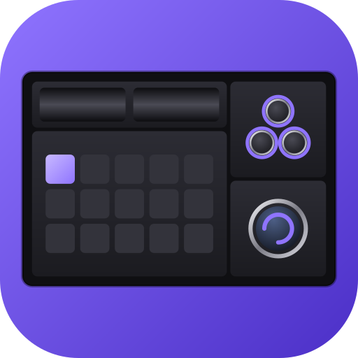

# opendeck-masterhub

An [OpenDeck](https://github.com/nekename/OpenDeck) device plugin for the Cooler Master MasterHUB, on macOS,
Windows and Linux, without the official app.

*Not affiliated with or endorsed by Cooler Master. MasterHUB is a trademark of Cooler Master.*


**The [user guide](docs/guide.md) describes every function in detail, with screenshots.**

## Contents

- [What it does](#what-it-does)
- [Install](#install)
- [Development](#development)
- [Generative AI disclosure](#generative-ai-disclosure)
- [License](#license)

## What it does

- **Every module is an OpenDeck device**: the 15xKey (15 keys with pictures and a background), 3xKnob, 2xRoller,
  Dial (with its round screen) and 5xFader, with any OpenDeck or Stream Deck plugin's actions on them.
  [→](docs/guide.md#the-modules-in-opendeck)
- **Placement like on the desk**: the plugin works out each module's socket and turn, and the base's orientation,
  so OpenDeck's positions match what you see; the settings page draws it live. Each module's physical layout goes
  to OpenDeck too, for the releases that can draw it.
  [→](docs/guide.md#placement-where-each-module-sits)
- **Screens for the dial and keys**: clock, analog clock, timer, CPU load, memory use, CPU and GPU temperature,
  GPU load. [→](docs/guide.md#actions)
- **App volume**: per-app volume (Spotify, Discord, a browser…) from a fader, knob, roller or the dial, shown on
  the dial's screen and the LEDs. [→](docs/guide.md#app-volume)
- **Command**: a command with a fader's position or the clicks turned, e.g. a monitor's brightness.
  [→](docs/guide.md#command)
- **Functions per knob**: up to 4 actions on a knob or the dial, switched with a press.
  [→](docs/guide.md#functions-per-knob)
- **Lighting**: knob, fader and base LEDs following their actions, App volume or a fader's position, signal LEDs
  driven by commands, stored in the modules if you like. [→](docs/guide.md#lighting)
- **Home Assistant**: every LED is a light there (MQTT discovery), with effects and flash.
  [→](docs/guide.md#home-assistant-and-other-programs)
- **15xKey background**: a picture or animated GIF behind the keys. [→](docs/guide.md#15xkey-background)
- **Live input**: everything the plugin reads from the modules, for checking and bug reports.
  [→](docs/guide.md#live-input)

| Module | Checked on hardware |
| --- | --- |
| M4315 15xKey w/ IPS | yes (macOS, Windows) |
| M003K 3xKnob | yes (macOS, Windows) |
| M032LE 2xRoller | yes (macOS, Windows) |
| M131E Dial w/ IPS | yes (macOS, Windows) |
| M005S 5xFader | yes (macOS, Windows) |
| M0064 Base | yes (macOS, Windows) |

## Install

1. Download **`opendeck-masterhub.zip`** from the latest release (the repository's *Releases* page). It works on macOS, Windows
   and Linux alike: it carries every platform's program and OpenDeck picks the right one.
2. In OpenDeck: **Plugins → Install from file**, choose the zip. OpenDeck installs and starts it at once, without a
   restart. To update, do the same with a newer release; the settings stay.
3. Plug the MasterHUB in. Close the official MasterHUB app if it runs: it may hold the device.

That's all on macOS and Windows. Optional extras:

| System | For | Install |
| --- | --- | --- |
| macOS | App volume (per-app volume) | [FineTune](https://github.com/ronitsingh10/FineTune): `brew install --cask finetune` |
| Windows | CPU and GPU temperatures when the system shows none | [LibreHardwareMonitor](https://github.com/LibreHardwareMonitor/LibreHardwareMonitor) with its web server on (port 8085) |
| Linux | **needed once**: access to the modules without root | the command below, then replug the MasterHUB |

```sh
echo 'SUBSYSTEM=="hidraw", ATTRS{idVendor}=="2516", ATTRS{idProduct}=="01f6|9999|01fe|9997|0202|9996|0200|9991|0204|9995|0206|9994", TAG+="uaccess"' | sudo tee /etc/udev/rules.d/70-masterhub.rules && sudo udevadm control --reload-rules && sudo udevadm trigger
```

The same rule is in `linux/70-masterhub.rules`. OpenDeck from Flathub works the same way.

**macOS and the MQTT password.** The password for Home Assistant's broker is kept in the macOS Keychain. The
plugin isn't signed, so macOS ties the Keychain's permission to this exact build: after every update of the plugin
macOS asks once whether it may read the password. Choose **Always Allow**; with **Allow** it asks again at every
start of OpenDeck, and with **Deny** the plugin can't connect to the broker.

Unpacking the zip by hand into OpenDeck's `plugins` folder works too; on macOS the system may then block the
downloaded program: `xattr -dr com.apple.quarantine <plugins folder>/com.masterhub.opendeck.sdPlugin`. Installing
through OpenDeck avoids that.

### From source

Needs [Rust](https://rustup.rs). Builds for this computer and installs into OpenDeck; restart OpenDeck afterwards.

- macOS / Linux: `./install.sh`. On Linux it also installs into OpenDeck from Flathub when present; building needs
  the `libudev` headers (`libudev-dev` on Debian/Ubuntu, `systemd-devel` on Fedora).
- Windows: `powershell -ExecutionPolicy Bypass -File install.ps1` (with OpenDeck closed).

Each build puts the program in `bin/<target triple>/`, which `CodePaths` in `manifest.json` maps per platform, so
one plugin folder carries macOS (Intel and Apple Silicon), Windows and Linux (x86-64, ARM) side by side.

## Development

```sh
cargo test
```

- **Documents**:
  - [docs/guide.md](docs/guide.md): the user guide;
  - [docs/sdk-commands.md](docs/sdk-commands.md): how the MasterHUB talks to the computer (plain USB HID), the
    report types and every command of the official SDK;
  - [docs/masterhub-app-analysis.md](docs/masterhub-app-analysis.md): findings from the official app;
  - [docs/unreleased-modules.md](docs/unreleased-modules.md): modules the SDK and app know but that aren't on sale;
  - [docs/device-layout-plan.md](docs/device-layout-plan.md): showing the modules' physical layout once OpenDeck
    ships explicit device layouts ([nekename/OpenDeck#359](https://github.com/nekename/OpenDeck/pull/359));
  - [docs/macos-roller-set-idle.md](docs/macos-roller-set-idle.md): why the 2xRoller needs SET_IDLE on macOS.
- **Icon**: `com.masterhub.opendeck.sdPlugin/icon.svg` (also the repository's, `docs/images/icon.png`) is a
  MasterHUB base lying flat with a 2xRoller, 15xKey, 3xKnob and Dial, drawn to scale from the plugin's placement
  model; `category.svg` is the same as a white line drawing for the action list.
- **Source**: `src/main.rs` (configuration, main loop, input routing, lights), `src/device.rs` (the module threads,
  input parsing, every report sent), `src/web.rs` (the settings page), `src/pictures.rs` (key and dial images),
  `src/placement.rs` (sockets, turns and the drawings), one file per action and integration besides.
- **Previews**: `cargo test docs_preview -- --ignored --nocapture` serves the settings page with a realistic set-up
  for 10 minutes (`MASTERHUB_PREVIEW=faders` for the one with a 5xFader): the documentation's screenshots.
  `cargo test dump_screens -- --ignored` draws every dial screen into `target/screens/`.
- **Dependencies**: `cargo audit` checks them; `.cargo/audit.toml` lists the reports that don't reach the plugin,
  and why.

### CI

`.gitea/workflows/ci.yml` runs clippy, the tests and a release build on self-hosted Gitea runners labelled `macos`
and `windows` (host mode, gitea-runner 4.x), the same for Linux in a Debian 13 container on the `macos` runner
(`ci/linux.sh`, needs Docker Desktop there), and `cargo audit`. It runs on pushes only, never on pull requests:
host-mode runners run jobs as you on your own machines.

- Set the runners up with `INSTANCE=<your Gitea> sh ci/setup-runner-macos.sh` and
  `ci/setup-runner-windows.ps1 -Instance <your Gitea>`. They ask for the
  registration token (Gitea → repository Settings → Actions → Runners → Create new runner); regenerate it
  afterwards.
- `rust-toolchain.toml` pins the Rust version every build uses; move it on deliberately.

### Releases

Push a tag such as `v0.2.0`. `.gitea/workflows/release.yml` then:

1. builds macOS (Apple Silicon and Intel), Linux (aarch64 and x86_64, the latter emulated so it takes a while;
   built on Debian 13, so it needs a system as new) and Windows (x64 and ARM64);
2. adds `opendeck-masterhub-<platform>.zip` for each to the Gitea release of that tag, created as a pre-release;
3. when all of them built, merges them into **`opendeck-masterhub.zip`** (`ci/release.py universal`), the one file
   users install, checks every platform is in it and makes the release a normal one. A failed platform leaves it
   a pre-release without that file; re-running a job replaces its file.

It needs the `RELEASE_TOKEN` secret (repository → Settings → Actions → Secrets): a Gitea access token with
repository write access, given only to the upload steps. The macOS programs aren't signed; installed through
OpenDeck they aren't quarantined, so macOS doesn't block them. The Windows runner builds both x64 and ARM64 (cross-
compiled); ARM64 needs the VS C++ ARM64 build tools and LLVM there, which `ci/setup-runner-windows.ps1` installs.

## Generative AI disclosure

This plugin was written with the help of generative AI: most of its code, tests, scripts and documentation, and
the translations of the documents into English, were drafted with Claude (Anthropic) working under the author's
direction. The author decided what the plugin does and how, reviewed the changes, and tested them on a real
MasterHUB. The protocol analysis in `docs/` was done the same way, on the author's copy of the official app; it
contains no code of Cooler Master's.

## License

[GPL-3.0-or-later](LICENSE). You may use, change and share the plugin. Anyone who passes it on, changed or
not, must pass on its source too, under the same license.
