# User guide

Everything the plugin does, part by part. Installing it is in the [README](../README.md#install).

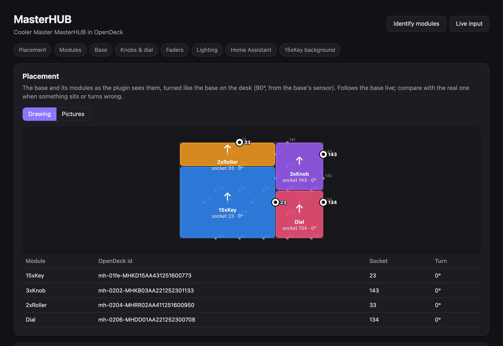

## Contents

- [First steps](#first-steps)
- [The modules in OpenDeck](#the-modules-in-opendeck)
  - [15xKey](#15xkey)
  - [3xKnob](#3xknob)
  - [2xRoller](#2xroller)
  - [Dial](#dial)
  - [5xFader](#5xfader)
  - [Base](#base)
- [Placement: where each module sits](#placement-where-each-module-sits)
- [The settings page](#the-settings-page)
  - [Header: Identify modules, Live input](#header-identify-modules-live-input)
  - [Placement](#placement)
  - [Modules](#modules)
  - [Base](#base-1)
  - [Knobs & dial](#knobs--dial)
  - [Faders](#faders)
  - [Lighting](#lighting)
  - [Home Assistant (MQTT)](#home-assistant-mqtt)
  - [15xKey background](#15xkey-background)
  - [Saving](#saving)
- [Live input](#live-input)
- [Actions](#actions)
  - [Screens: clock, analog clock, CPU, memory, temperatures, GPU](#screens-clock-analog-clock-cpu-memory-temperatures-gpu)
  - [Timer](#timer)
  - [App volume](#app-volume)
  - [Command](#command)
  - [LED lighting](#led-lighting)
- [Functions per knob](#functions-per-knob)
- [How a knob's or fader's LED is chosen](#how-a-knobs-or-faders-led-is-chosen)
- [Home Assistant and other programs](#home-assistant-and-other-programs)
- [Behind the scenes](#behind-the-scenes)
- [Troubleshooting](#troubleshooting)
- [Safety](#safety)

## First steps

1. Plug the MasterHUB in and start OpenDeck. Close the official MasterHUB app if it runs: it may hold the modules.
2. Every module appears in OpenDeck's device list as a device of its own, named after the module, its socket on
   the base and its turn, e.g. `MasterHUB 15xKey · port 23 · 0°`. The base isn't a device (it has no controls).
3. Pick a module in the device list and drag actions onto its keys or encoders, as with a Stream Deck. Any
   OpenDeck or Stream Deck plugin's actions work; the plugin's own are in the **MasterHUB** category.
4. OpenDeck → Plugins → *Cooler Master MasterHUB* → settings opens the plugin's [settings page](#the-settings-page)
   in the browser.

Modules can be plugged in, moved and taken off while OpenDeck runs: the plugin looks for changes every 2 seconds.

## The modules in OpenDeck

In OpenDeck a knob, roller, the dial and a fader are all *encoders*: a turn sends clicks (`dialRotate` with
`ticks`, negative to the left), a press sends `dialDown` / `dialUp`. Keys are *keys*. Positions are counted the
way you see the module on the desk, whatever way it's turned (see [Placement](#placement-where-each-module-sits)).

| Module | Model | In OpenDeck | Screens | LEDs |
| --- | --- | --- | --- | --- |
| 15xKey | M4315 | 5 × 3 keys (3 × 5 turned by 90° or 270°) | a 72 × 72 picture per key, a background behind them | — |
| 3xKnob | M003K | 3 encoders (×1–4 with [functions](#functions-per-knob)) | — | one RGB LED per knob |
| 2xRoller | M032LE | 2 encoders | — | — |
| Dial | M131E | 1 encoder (×1–4 with functions) and 1 key | a round 240 × 240 screen | — |
| 5xFader | M005S | 5 encoders | — | one RGB LED per fader |
| Base | M0064 | not a device | — | one RGB LED |

Both product ids of every module are recognised.

**The modules' real shape.** OpenDeck draws a device as a grid of keys and a row of encoders, so the 3xKnob's
triangle shows as a line and faders and rollers as knobs. The plugin also sends each module's physical layout
(knobs in their triangle, faders and rollers as bars, the round dial with its key, turned like the module) in the
format of [OpenDeck's draft PR #359](https://github.com/nekename/OpenDeck/pull/359). OpenDeck releases without it
ignore the layout and draw the grid as before; with it, the modules look like the real ones. Positions are the same
either way, so actions stay where they are.

### 15xKey

- **Keys**: 15 keys in 5 columns and 3 rows; turned by 90° or 270° on the base, OpenDeck shows 3 columns and
  5 rows, so the top-left key in OpenDeck is always the top-left key on the desk.
- **Pictures**: each key shows its action's picture; a pressed key shows it shrunk, like a key going down.
  Key pictures aren't turned with the module unless **Turn pictures upright** is on ([Base](#base-1)).
- **Brightness**: OpenDeck's brightness setting sets the module's screen brightness. At 0 (also when OpenDeck
  puts devices to sleep) the screen goes black and the pictures come back with the brightness; the module itself
  is never sent 0, which can leave it dark until it's taken off the base.
- **Background**: one picture, or an animated GIF, across the whole module behind the keys
  ([15xKey background](#15xkey-background)).

### 3xKnob

- **Encoders**: knob 1 bottom left, knob 2 bottom right, knob 3 at the top (on a module standing upright); turned
  modules are renumbered so the order stays the one you see.
- **Turn** sends clicks; **press** sends a press. With [functions per knob](#functions-per-knob) a short press
  switches function instead.
- **LEDs**: each knob's ring takes a colour from its action ([how](#how-a-knobs-or-faders-led-is-chosen)) once the
  plugin [manages the lighting](#lighting).
- **Acceleration** (setting): fast turns count up to 3× the clicks.

### 2xRoller

- **Encoders**: the left roller is position 1, the right one 2 (the module itself reports the right one first;
  the plugin swaps them).
- **Roll** sends clicks; the rollers have no press and no LEDs.
- On macOS the plugin wakes the rollers when they connect (see [Behind the scenes](#behind-the-scenes)).

### Dial

- **Encoder**: turn and press, like a knob.
- **Key**: OpenDeck also shows a key next to the dial's encoder. An action put on that key takes the dial's
  press (e.g. volume on the turn, play/pause on the press); without one the press goes to the turn's action.
- **Screen**: the round 240 × 240 screen shows the turn action's picture, or what
  [The dial's screen shows](#knobs--dial) says; the plugin's screen actions draw it full screen
  ([gallery](#screens-clock-analog-clock-cpu-memory-temperatures-gpu)).
- **Brightness**: OpenDeck's brightness setting sets the screen's; at 0 it goes black, as on the 15xKey.
- With functions, switching shows a card with the function's number (`F2`) for a second.

### 5xFader

- **Encoders**: faders 1–5 from the left. Moving a fader sends clicks: its change in percent times
  **Ticks per 1%** ([Faders](#faders)); 1 by default, so the full travel is 100 clicks. Fractions carry over, so a
  slow move isn't lost.
- **Absolute position**: the plugin also knows where each fader stands (0–100), read when the module connects.
  Its own actions use that: [App volume](#app-volume) sets the level to the fader's position and
  [Command](#command) gets it as `{value}`. Other plugins' actions only see the clicks.
- **Jitter**: a resting fader sends nothing (changes under 2% are ignored, the ends snap to 0 and 100).
- **LEDs**: one per fader, coloured like knob LEDs, or as a level meter of the fader's position.

### Base

- **LED**: its colour is set on the settings page ([Lighting](#lighting)) or from Home Assistant.
- **Orientation**: a tilt sensor tells whether the base stands upright or lies flat; the plugin turns everything
  by 90° when it lies flat, or uses the turn picked by hand ([Base](#base-1)).
- **USB**: the base has two USB-C ports. They are interchangeable (the same hub behind both), so the plugin
  can't tell which one the cable is in.

## Placement: where each module sits

Like the official app, the plugin works out each module's socket from the USB port it's connected to on the
base's hub, and from the socket where on the base the module sits and which way it's turned. With the base's own
orientation it then arranges the key grid and the encoder order to match the desk. The settings page draws it,
two arrangements here:

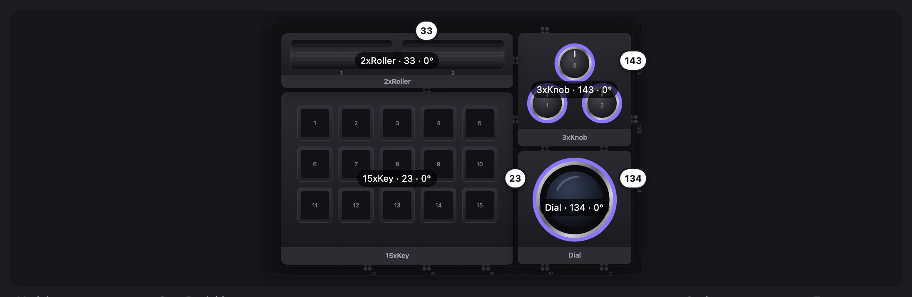

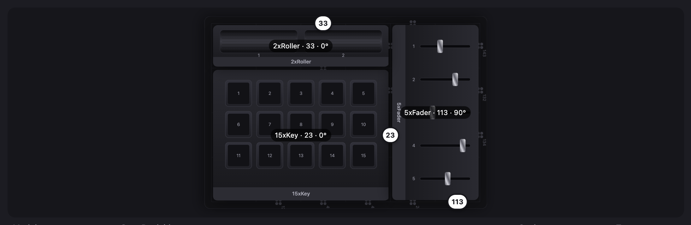

Each control carries its OpenDeck position, the white badges are the sockets the modules are plugged into, and the
caption is `module · socket · turn`.

## The settings page

OpenDeck → Plugins → *Cooler Master MasterHUB* → settings. The page follows the system's light or dark mode.

### Header: Identify modules, Live input

- **Identify modules**: for 10 seconds every 15xKey key shows its OpenDeck position as a number, the dial its
  turn, and the LEDs light by OpenDeck position: 1 red, 2 green, 3 blue, 4 yellow, 5 magenta, the base white.
  Then everything goes back.
- **Live input** opens the [live input page](#live-input) in a new tab.
- The row of buttons below jumps to a section.

### Placement


The base and its modules as the plugin sees them, turned like the base on the desk; the line above the views
says how the base is turned and whether that comes from its sensor or from the setting. The page asks the plugin
every second, so moving a module or turning the base shows without reloading.

- **Drawing**: the base's grid with every socket numbered, each module as a coloured block with an arrow towards
  its top, and a badge on the socket each module uses.
- **Pictures**: the plugin's own drawings of the base and modules ([above](#placement-where-each-module-sits)),
  with every key, knob, fader and roller numbered by its OpenDeck position.
- **Table**: module, its OpenDeck device id, socket and turn on the desk.

Compare it with the real base when something sits or turns wrong in OpenDeck. The choice of view is saved.

### Modules

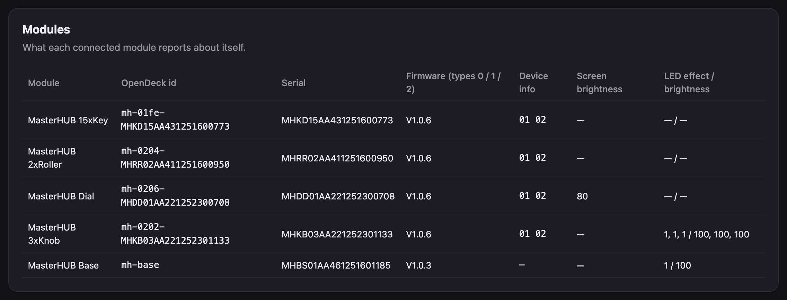

What each connected module, and the base, reports about itself:

| Column | Meaning |
| --- | --- |
| Module | its name |
| OpenDeck id | the device id in OpenDeck (`mh-<product id>-<serial number>`), also used in Home Assistant's topics |
| Serial | the serial number |
| Firmware (types 0 / 1 / 2) | the firmware versions the module reports |
| Device info | the module's device info bytes, as read |
| Screen brightness | the dial's screen brightness |
| LED effect / brightness | per LED, the effect number (0 off, 1 static … 9 rainbow) and brightness the module reports |

### Base

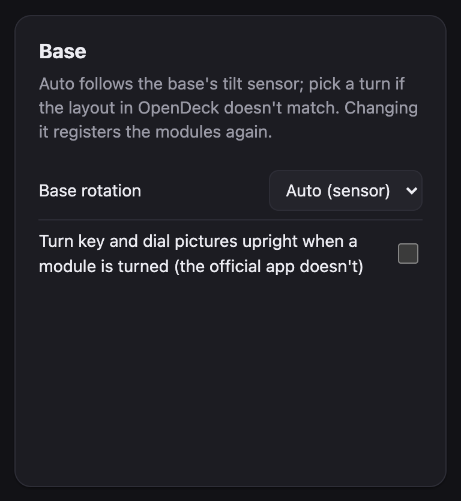

- **Base rotation**: *Auto (sensor)* follows the base's tilt sensor; 0°, 90°, 180° or 270° turns everything by
  hand, for when the layout in OpenDeck doesn't match the desk. Changing it registers the modules again.
- **Turn key and dial pictures upright when a module is turned**: off by default, like the official app (pictures
  turn with the module). On, a turned 15xKey's key pictures and the dial's screen are turned back so they stand
  upright.

### Knobs & dial

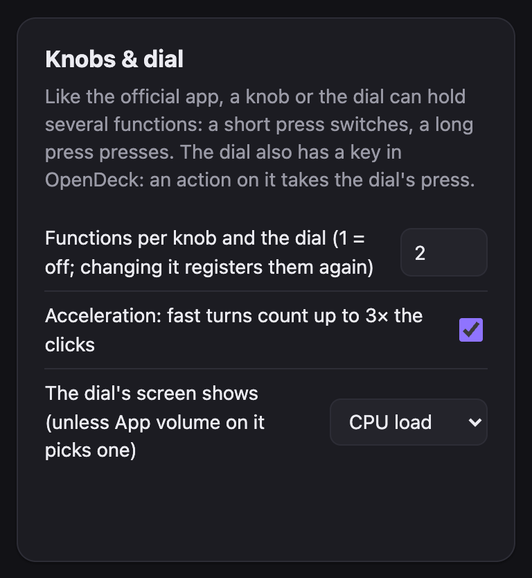

- **Functions per knob and the dial** (1–4): several actions on one knob or the dial, switched with a short press
  ([how it works](#functions-per-knob)). 1 turns it off. Changing it registers the knobs and the dial again.
- **Acceleration**: fast turns of knobs, rollers and the dial count up to 3× the clicks.
- **The dial's screen shows**: *What its turn action shows* (the action's picture), or always a clock, analog
  clock, CPU load, memory use, CPU temperature, GPU load or GPU temperature. An [App volume](#app-volume) action on
  the dial picks its own screen instead.

### Faders

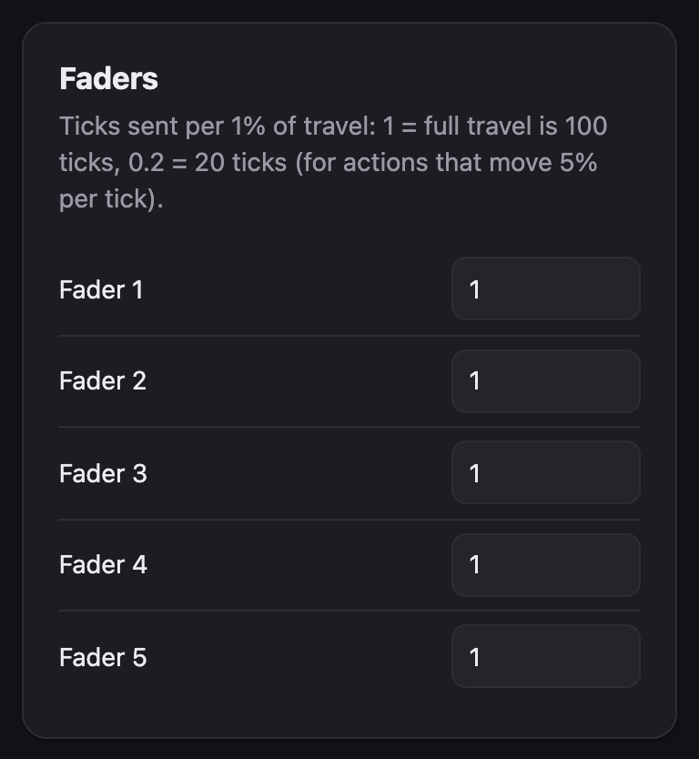

**Fader 1–5**: clicks sent per 1% of the fader's travel (0.01–100). 1 means the full travel is 100 clicks; 0.2
makes it 20, for an action that moves 5% per click. The plugin's own App volume and Command use the fader's
position directly and aren't affected.

### Lighting

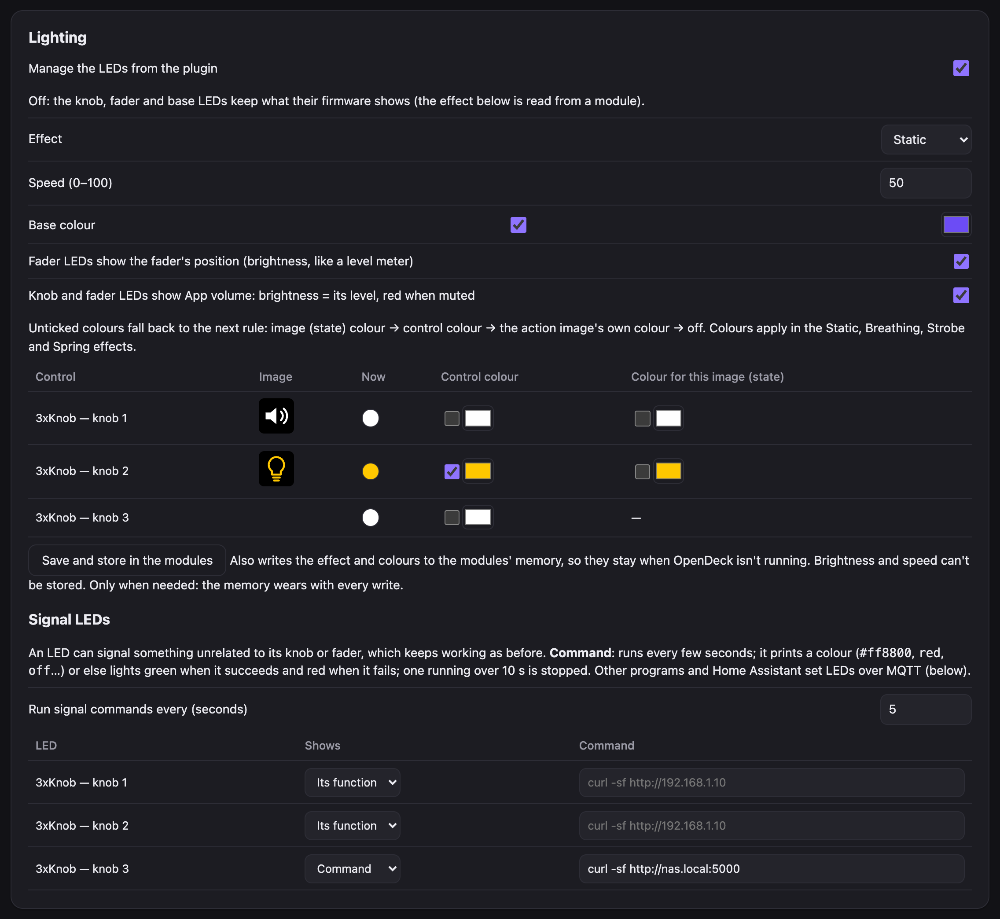

The knob, fader and base LEDs. With faders the table lists them too:

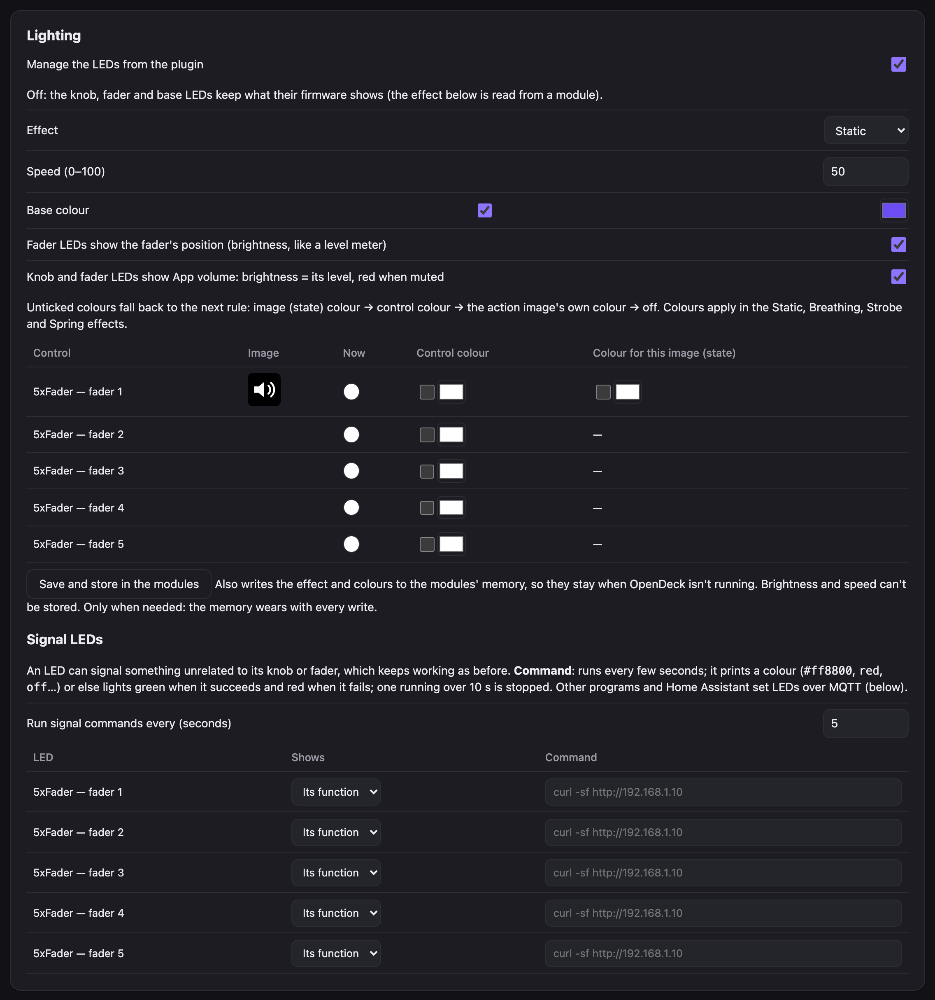

- **Manage the LEDs from the plugin**: off by default, and then the plugin leaves the LEDs alone: they show what
  their firmware shows, and the page shows the effect read from a module. On, the plugin sets them as below.
  An [LED lighting](#led-lighting) action turns it on too.
- **Effect**: the firmware's effects: Off, Static, Breathing, Strobe, Spring, Cycling, Random, Wave, Water,
  Rainbow. Colours apply in Static, Breathing, Strobe and Spring; the others make their own.
- **Speed (0–100)**: how fast the effect runs. One speed per module (the firmware has no per-LED speed).
- **Base colour**: tick it to set the base's LED colour; unticked, the base keeps its own.
- **Fader LEDs show the fader's position**: each fader's LED brightness follows its fader, like a level meter,
  in the fader's colour (white when it has none).
- **Knob and fader LEDs show App volume**: on a knob or fader with an [App volume](#app-volume) action, the LED's
  brightness is the app's level and it turns red when muted.
- **Table**, one row per knob and fader (per function with several functions):

  | Column | Meaning |
  | --- | --- |
  | Control | the module and control |
  | Image | the picture its action shows now (each state of an action has its own picture) |
  | Now | the colour the LED shows now |
  | Control colour | tick and pick a colour for this control, whatever its action shows |
  | Colour for this image (state) | tick and pick a colour for the picture shown now, e.g. red for a "muted" picture; it applies whenever that picture is shown |

  The order is explained in [How a knob's or fader's LED is chosen](#how-a-knobs-or-faders-led-is-chosen).
- **Save and store in the modules**: saves, and also writes the effect and colours into the modules' memory so
  they stay when OpenDeck isn't running. Brightness and speed can't be stored, nor signals, Home Assistant's
  colours or App volume's level. Use it only when needed: the memory wears with every write.
- **Signal LEDs**: any knob or fader LED can show something unrelated to its control, which keeps working as
  before. **Shows**: *Its function* (normal) or *Command*. The **command** runs every few seconds through the
  system shell (`sh`, `cmd` on Windows) and either prints a colour (`#ff8800`, `red`, `green`, `blue`, `yellow`,
  `orange`, `purple`, `cyan`, `white`, `off`) or else lights the LED green when it succeeds and red when it fails.
  Examples: `curl -sf http://192.168.1.10` (is the NAS up), `pgrep zoom.us >/dev/null && echo red || echo off`
  (in a call). A command running over 10 s is stopped. **Run signal commands every (seconds)**: 1–3600.
- OpenDeck's brightness setting also dims the LEDs while the plugin manages them. The plugin sends the lighting
  again every minute, as the official app does.

### Home Assistant (MQTT)

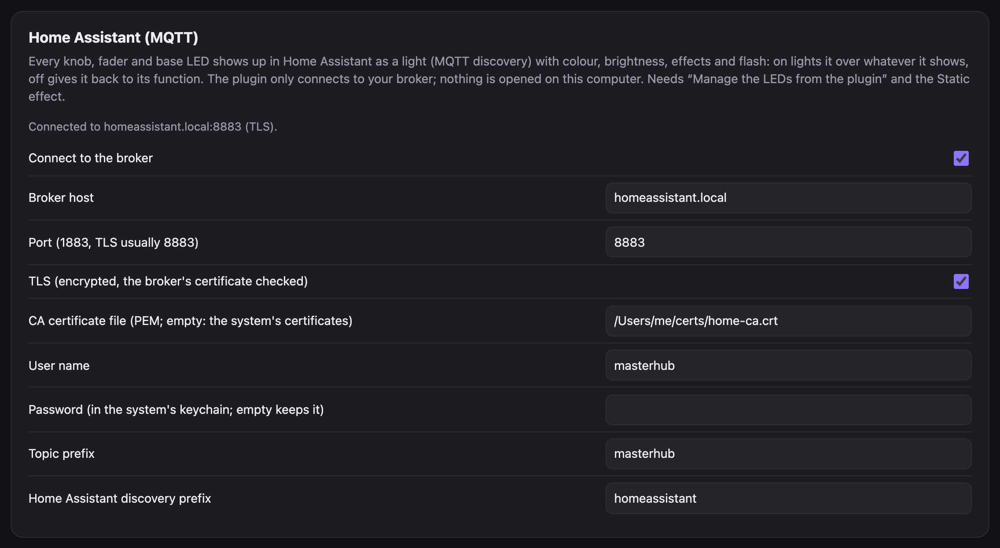

Every knob, fader and base LED appears in Home Assistant as a light ([details](#home-assistant-and-other-programs)).
Needs **Manage the LEDs from the plugin** and the Static effect. The line at the top says how the connection is
doing.

- **Connect to the broker**: on or off.
- **Broker host** and **Port**: your MQTT broker, e.g. Home Assistant's Mosquitto add-on (1883; 8883 with TLS).
- **TLS**: encrypted, and the broker's certificate is always checked.
- **CA certificate file**: a PEM file with the certificate authority that signed the broker's certificate
  (the usual case for a home broker); only that CA is then trusted. Empty: the system's certificates.
- **User name** and **Password**: the broker's account; give the plugin one of its own. The password goes into
  the system's keychain and never comes back to the page: leave the field empty to keep it; an empty user name
  removes it. The label says where it's kept. On macOS the plugin isn't signed, so after every update of the
  plugin macOS asks once to let it read the password from the Keychain: choose **Always Allow** (with **Allow**
  it asks at every start of OpenDeck).
- **Topic prefix** (`masterhub`) and **Home Assistant discovery prefix** (`homeassistant`): change them only if
  your setup needs it; they can't be the same.

### 15xKey background

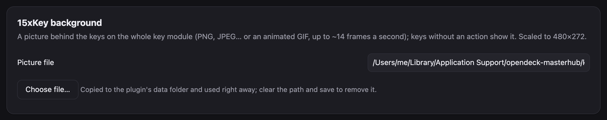

A picture behind the keys on the whole 15xKey (PNG, JPEG, … or an animated GIF), scaled to the module's
480 × 272 screen. Keys without an action show it; keys with one show their picture in their place. A GIF plays
at up to ~32 frames a second, what the 15xKey shows without missing a frame. To try another rate, set
`MASTERHUB_MIN_FRAME_MS` (10–1000, the shortest a frame stays) before starting OpenDeck.

- **Choose file…** copies the picture into the plugin's data folder and uses it at once
  (`~/Library/Application Support/opendeck-masterhub`, `%APPDATA%\opendeck-masterhub`,
  `~/.local/share/opendeck-masterhub`), so it stays when the original moves. Up to 32 MB.
- **Picture file**: the path in use; a path can be typed instead. Clear it and save to remove the background.

### Saving

**Save** at the bottom of the page keeps every section's settings (in OpenDeck's plugin settings; the MQTT
password in the keychain) and applies them at once. Enter in any field saves too. A note at the bottom says what
was saved, and what wasn't taken (e.g. a colour that isn't one).

## Live input

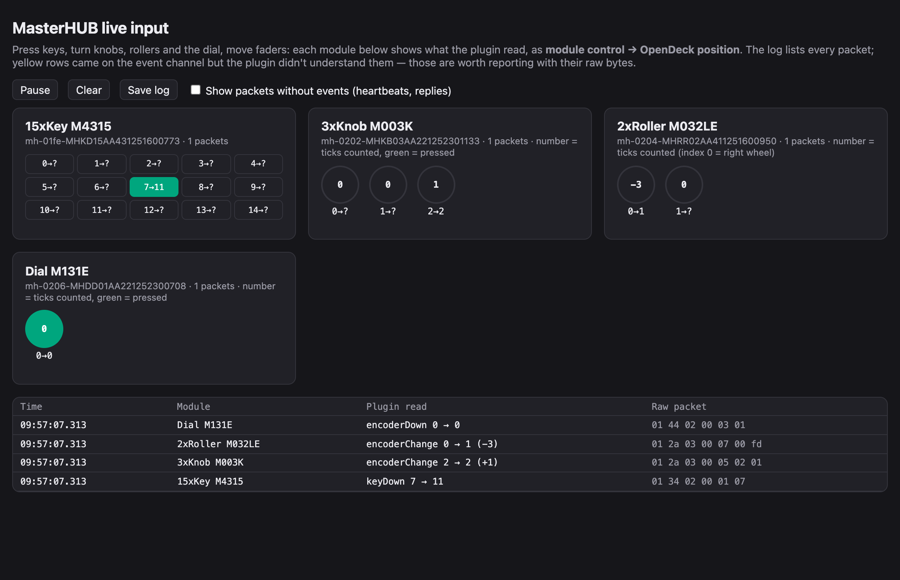

Press keys, turn knobs, rollers and the dial, move faders: each module shows what the plugin read, as
`module control → OpenDeck position`, with fader positions as bars and turn counters per encoder:

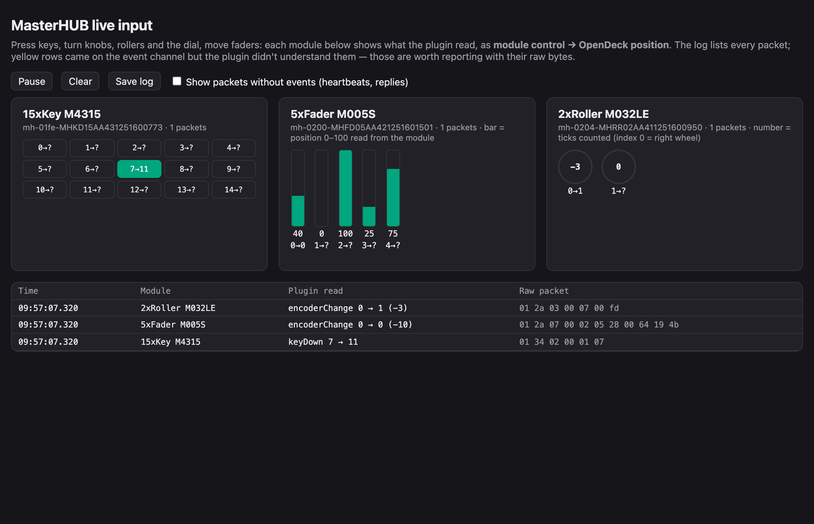

- **Log**: every input packet with its time, module, what the plugin made of it and the raw bytes. Yellow rows came
  on the event channel but the plugin didn't understand them: worth reporting.
- **Pause**, **Clear**, **Save log** (a JSON file with the last 20 000 packets, for a bug report), **Show packets
  without events** (heartbeats and replies, hidden by default).

## Actions

Category **MasterHUB** in OpenDeck's action list. Every action works on a key, a knob, a roller, the dial or a
fader, on the MasterHUB or on any other device OpenDeck drives.

### Screens: clock, analog clock, CPU, memory, temperatures, GPU

Screens: on the MasterHUB dial they draw its whole screen; on a key or another device OpenDeck shows the same
picture.

| | | | |
| --- | --- | --- | --- |
| 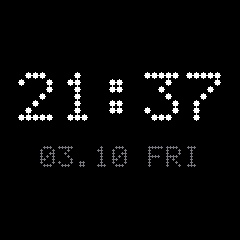 | 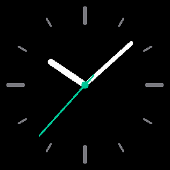 | 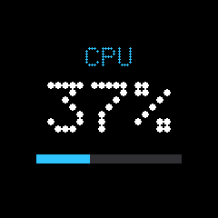 | 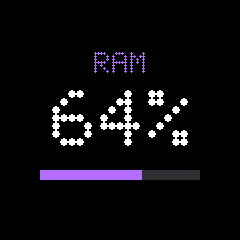 |
| **Clock**: `HH:MM` and the date | **Analog clock**: hour, minute and second hands | **CPU load**: percent and a bar | **Memory use**: RAM used, percent |
| 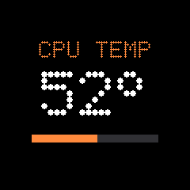 | 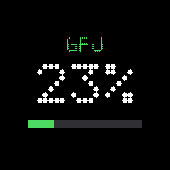 | 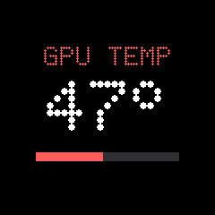 | |
| **CPU temperature**: the hottest CPU sensor | **GPU load** | **GPU temperature**: the first GPU | |

Values are refreshed every second. `--` means the system doesn't give the value:

| | macOS | Windows | Linux |
| --- | --- | --- | --- |
| CPU temperature | the system's sensors | the system's sensors (often none without admin rights), else LibreHardwareMonitor | the system's sensors |
| GPU load | `ioreg` | `nvidia-smi`, else LibreHardwareMonitor | `nvidia-smi`, sysfs (AMD, Intel) |
| GPU temperature | — (needs the SMC) | `nvidia-smi`, else LibreHardwareMonitor | `nvidia-smi`, sysfs |

LibreHardwareMonitor is read through its web server (Options → Remote Web Server, port 8085).

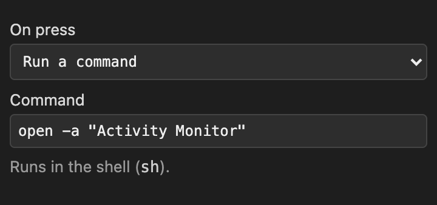

**On press** (in the action's settings):

- **Nothing**.
- **Open an app, file or web address**, e.g. `/System/Applications/Utilities/Activity Monitor.app`,
  `C:\Windows\System32\Taskmgr.exe` or `https://…`; opened with the system's own opener, no shell.
- **Run a command** in the system shell, e.g. `open -a "Activity Monitor"`.
- **Next screen**: clock → analog clock → CPU → memory → CPU temperature → GPU → GPU temperature, kept in the
  action's settings.

### Timer

| | | |
| --- | --- | --- |
| 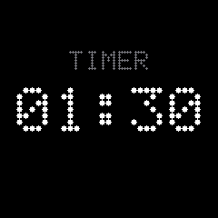 | 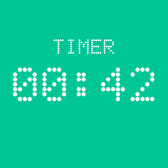 |  |
| set (60 s at first) | running, green | done, for 2 s |

- **Turn** (on an encoder, while stopped): ±10 seconds per click, from 10 s to 99:59; kept in the action.
- **Press**: start; press again to stop and reset.
- On a key it starts and stops; set the time on an encoder.

### App volume

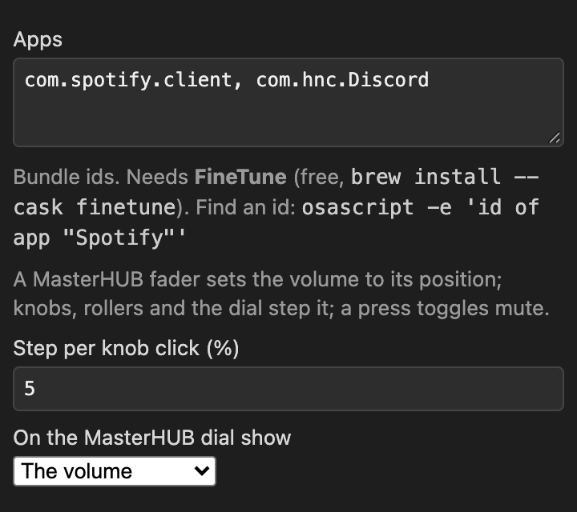

The volume of chosen apps.

| | 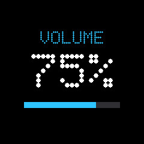 | 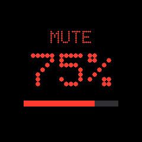 |
| --- | --- | --- |
| On the dial | the level | muted |

**Settings:**

- **Apps**: one or more, separated by commas or new lines (up to 10).

  | System | Apps by | Needs |
  | --- | --- | --- |
  | macOS | bundle id, e.g. `com.spotify.client`; find one with `osascript -e 'id of app "Spotify"'` | [FineTune](https://github.com/ronitsingh10/FineTune), a free menu bar app: `brew install --cask finetune` |
  | Windows | process name as in Task Manager → Details, e.g. `spotify`, `discord` (".exe" optional) | nothing |
  | Linux | program name as in `pactl list sink-inputs`, e.g. `spotify`, `firefox` | `pactl` (PulseAudio or PipeWire) |

  Every audio stream of the app counts (a browser's helper processes too).
- **Step per knob click (%)**: 1–25, default 5.
- **On the MasterHUB dial show**: *The volume* (default) or a clock, CPU, … screen while the turn still sets the
  volume.

**What it does:**

- **On a 5xFader**: sets the volume to the fader's position (0–100%). On macOS the scale is FineTune's own slider's,
  so 50% on the fader shows 50% in FineTune.
- **On a knob, roller or the dial**: steps the volume by the step; clicks that come faster than the system takes
  them add up.
- **Press, or on a key**: toggles mute.
- **Shows the level**: the action's title (`45%` or `MUTE`), the dial's screen, and a knob's or fader's LED
  (brightness = level, red when muted; [Lighting](#lighting)).
- On macOS FineTune can't be asked for a level: the plugin reads it from FineTune's saved settings about 0.7 s
  after a change, and when the action appears.

### Command

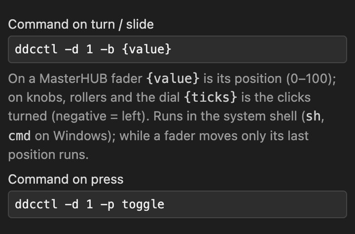

Runs a command line in the system shell (`sh`; `cmd` on Windows).

- **Command on turn / slide**:
  - on a 5xFader `{value}` is the fader's position (0–100), e.g. `ddcctl -d 1 -b {value}` for a monitor's
    brightness; while the fader moves only its last position runs;
  - on knobs, rollers and the dial `{ticks}` is the clicks turned (negative = left); clicks that come while the
    command runs add up into its next run;
  - it runs for at most 10 s; past that it's stopped with everything it started.
- **Command on press** (optional): runs on a press, or on a key, without waiting for it (it may start an app).

### LED lighting

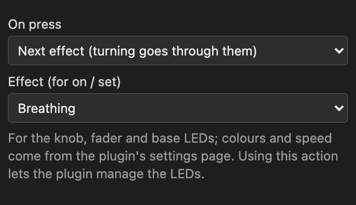

Controls the knob, fader and base LEDs from a key or encoder; its title shows the effect in use.

- **On press**:
  - **Turn the LEDs off / on**: off, then back on with the chosen effect;
  - **Next effect**: the next of the nine effects; turning an encoder steps through them both ways;
  - **Set the effect**: the chosen one.
- **Effect**: for *on* and *set*.
- Using it makes the plugin manage the LEDs (as **Manage the LEDs from the plugin**); colours and speed come from
  the settings page.

## Functions per knob

As in the official app, a knob or the dial can hold up to 4 functions. With **Functions per knob and the dial**
set to 2–4 on the settings page:

- Each knob and the dial get that many encoder slots in OpenDeck: function 1 of every knob first, then function 2
  of every knob, and so on, so actions already on the knobs stay function 1. Put an action in each slot.
- A **turn** goes to the current function's action.
- A **short press** switches to the next function that has an action (a function whose action was removed is
  skipped); a **long press** (600 ms or more, as in the official app) presses the current function's action. With
  only one function in use a press goes straight to its action.
- A knob's LED shows the current function's colour; the dial shows a card with the function's number (`F2`) for
  a second, then the function's screen.

## How a knob's or fader's LED is chosen

While the plugin manages the LEDs, the first that applies wins:

1. **Identify mode** (10 s).
2. **Home Assistant**: a flash, or the light turned on (its colour, brightness and effect).
3. **A signal LED's command**: the colour it gave.
4. **App volume muted**: red, when the action on it is App volume and **Knob and fader LEDs show App volume** is
   on.
5. Otherwise **the colour**, the first of:
   1. the colour picked for the picture the action shows now (**Colour for this image**; it applies to that
      picture on any knob or fader);
   2. the colour picked for the control (**Control colour**);
   3. the action picture's own colour: its most colourful bright part, at full brightness, so a red icon lights
      red;
   4. off, when there's no action (white for a fader showing its position, so the level still shows).

   and **the brightness**: App volume's level (never quite dark, so the knob still shows), or the fader's
   position when **Fader LEDs show the fader's position** is on, or else OpenDeck's brightness.

Effects other than Static, Breathing, Strobe and Spring make their own colours. OpenDeck can't tell a device plugin
another plugin's state (it sends finished pictures only), which is why colours go by picture.

## Home Assistant and other programs

The plugin only connects out to your MQTT broker; nothing on the computer listens on the network.

**In Home Assistant** (MQTT discovery, nothing to configure there). The screenshots are from a Home Assistant set
to Polish:

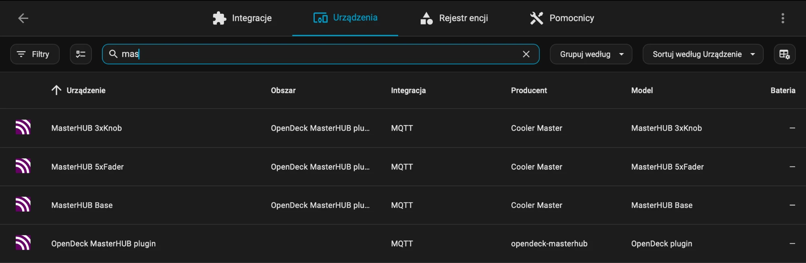

| | |
| --- | --- |
| 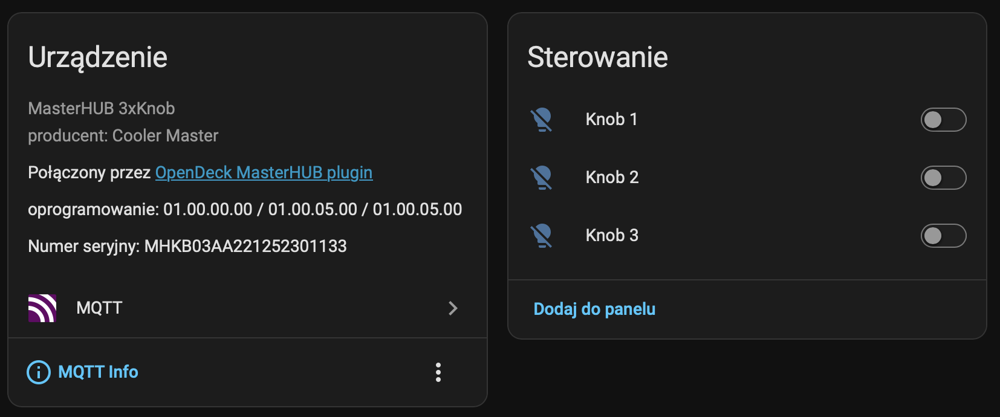 | 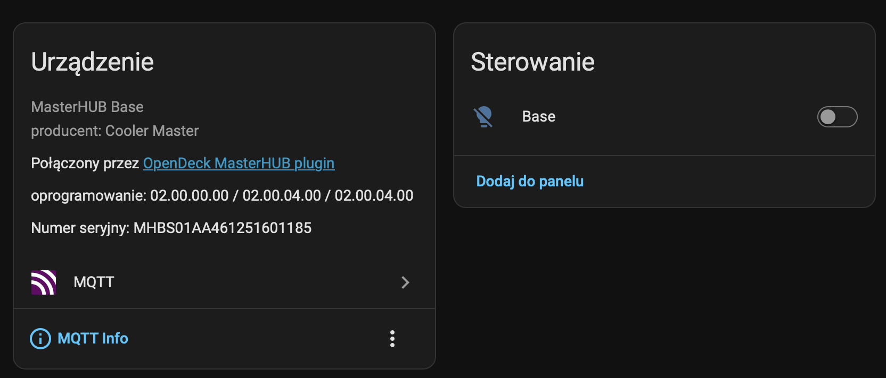 |
| *MasterHUB 3xKnob*: its three LEDs | *MasterHUB Base*: its LED |
| 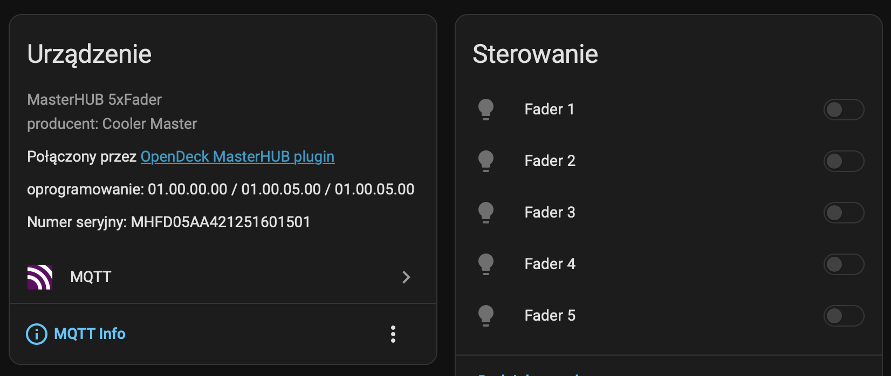 | 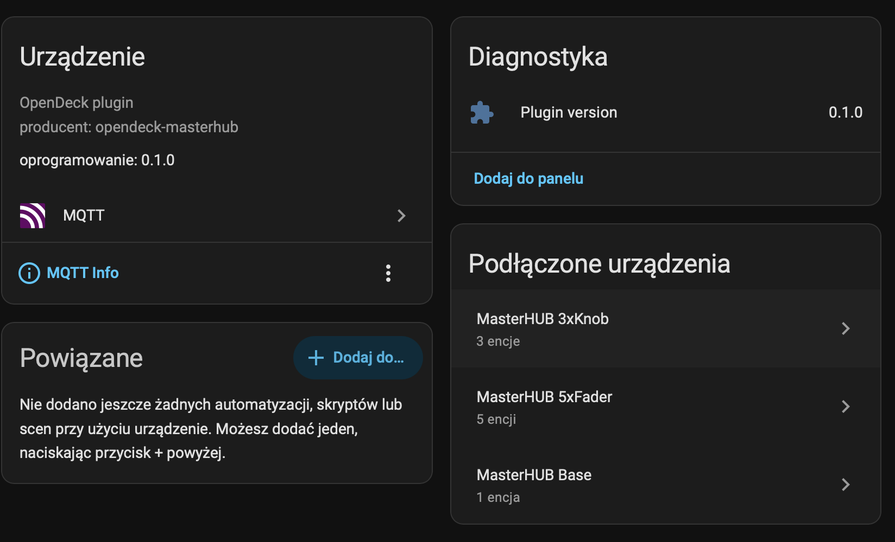 |
| *MasterHUB 5xFader*, unplugged at the time, so its lights show as unavailable | *OpenDeck MasterHUB plugin*: its version and the modules it connects |


- **One device per module**, e.g. *MasterHUB 3xKnob*, with its model, serial number and firmware, connected via
  *OpenDeck MasterHUB plugin*.
- **Lights**: *Knob 1–3*, *Fader 1–5* (numbered as in OpenDeck) and *Base*, each with an RGB colour picker,
  brightness and effects. Turning a light on shows that colour on the LED over whatever it showed; turning it off
  gives the LED back to its function.
- **Effects** (drawn by the plugin, so each LED can have its own): Solid, Pulse (2 s), Slow pulse (5 s), Blink
  (1 s), Fast blink (4 a second), Rainbow (6 s round the colour wheel).
- **Flash**: `light.turn_on` with `flash: short` blinks fast for 2 s, `flash: long` slowly for 10 s, in the colour
  given; then the LED shows what it showed before and the light's state doesn't change.

  ```yaml
  # the washing machine is done: knob 3 blinks orange for 10 s
  action: light.turn_on
  target: { entity_id: light.masterhub_3xknob_knob_3 }
  data: { flash: long, rgb_color: [255, 120, 0] }
  ```

- **The plugin's own device**, *OpenDeck MasterHUB plugin*, has a diagnostic sensor with the plugin's version and,
  as attributes, OpenDeck's version, the system and every module's serial number and firmware.
- **Available / unavailable**: a module unplugged, or the plugin gone (closing OpenDeck, a crash: the broker
  tells), shows as unavailable.

**Any other program** can use the same topics (JSON, Home Assistant's JSON light schema):

| Topic | Use |
| --- | --- |
| `masterhub/<module id>/<control>/set` | send `{"state":"ON","color":{"r":255,"g":136,"b":0},"brightness":255,"effect":"Pulse"}` or `{"state":"OFF"}` |
| `masterhub/<module id>/<control>/state` | the light's state (retained) |
| `masterhub/<module id>/availability` | `online` / `offline` for a module |
| `masterhub/status` | `online` / `offline` for the plugin |

`<module id>` is the OpenDeck id from the [Modules](#modules) table (`mh-base` for the base); `<control>` counts
from 0 (knob 1 is `0`). Commands for anything but an announced LED are ignored.

```sh
mosquitto_pub -h homeassistant.local -u masterhub -P … -t masterhub/mh-0202-MHKB03AA221252301133/2/set \
  -m '{"state":"ON","color":{"r":255,"g":0,"b":0},"effect":"Blink"}'
```

## Behind the scenes

- **Software mode**: the 15xKey and the dial show the plugin's pictures only in their software mode, which the
  plugin turns on and checks. Closing OpenDeck turns it off again, so they go back to their own screens.
- **Sleep**: after the computer wakes, the plugin sets every module up again 2 s later (software mode, pictures,
  LEDs), like the official app: modules can come back in hardware mode.
- **A stuck module** (a 15xKey or dial that doesn't confirm software mode): on macOS the plugin re-enumerates it
  over USB as if it were replugged, at most once a minute. Elsewhere that needs administrator rights, so the log
  asks for the module to be taken off the base and put back.
- **Locked-up firmware**: a 15xKey or dial asked for a feature report while in hardware mode can lock up until
  it's taken off the base. Its USB serial number then reads as garbage; the plugin doesn't register such a
  module (it would show up as a new device without your actions), says so in the log, and re-enumerates it on
  macOS. The plugin itself only reads the modules' information once they're in software mode.
- **Rollers on macOS**: the 2xRoller sends nothing until it gets the standard USB request SET_IDLE, which Windows
  and Linux send to every such device and macOS doesn't. The plugin sends it whenever the rollers connect; no
  admin rights needed ([details](macos-roller-set-idle.md)).
- **Updating**: install a newer `opendeck-masterhub.zip` the same way; the settings stay.

## Troubleshooting

- **Logs**: the plugin writes to OpenDeck's log folder, file `plugins/pl.kobylarek.masterhub.sdPlugin.log`:
  macOS `~/Library/Logs/opendeck/`, Windows `%APPDATA%\opendeck\logs\`, Linux `~/.local/share/opendeck/logs/`,
  Flatpak `~/.var/app/me.amankhanna.opendeck/data/opendeck/logs/`.
- **More detail**: start OpenDeck with `MASTERHUB_DEBUG=1` set: the log then lists every HID interface found and
  every raw input packet.
- **A 15xKey or dial stays blank**: another app holds it (often the official MasterHUB app). Close that app and
  replug the module; the log says when a module didn't confirm software mode or locked up. On Windows,
  `pnputil /restart-device "USB\VID_2516&PID_01FE\<serial>"` in an administrator terminal also restarts a 15xKey
  without taking it off (`PID_0206` for the dial; the serial is in the [Modules](#modules) table).
- **A module drops out for a moment on a press** (Windows plays its unplug sound; the log says `disconnected`),
  even with no software running: a loose contact between the module and the base. Take the module off and put it
  back firmly.
- **A module sits or turns wrong in OpenDeck**: compare the [Placement](#placement) section with the desk; if the
  base's sensor misreads, set **Base rotation** by hand.
- **Nothing on Linux**: the udev rule from the [README](../README.md#install) is needed once, then replug.
- **Home Assistant shows nothing**: check the connection line in the MQTT section, that **Manage the LEDs from
  the plugin** is on and the effect is Static.

## Safety

- **The settings page** is only reachable from this computer, behind a random 128-bit secret that only OpenDeck
  gets (through a one-time address, so it never shows on a command line or in the browser's history). Forms are
  sent with POST; the page runs only its own scripts.
- **Commands that could damage a module** (writing firmware, serial numbers or factory data, resetting or
  recalibrating) are refused in the plugin's code, whatever a bug might ask for.
- **The modules' memory** is written only by **Save and store in the modules**.
- **MQTT**: outgoing only, TLS with the certificate checked, the password in the system's keychain (on Linux
  without a desktop session, in a file only you can read).
- **Commands you enter** (signal LEDs, Command, screen presses) run as you, in the system shell, stopped after
  10 s where they're waited for.
